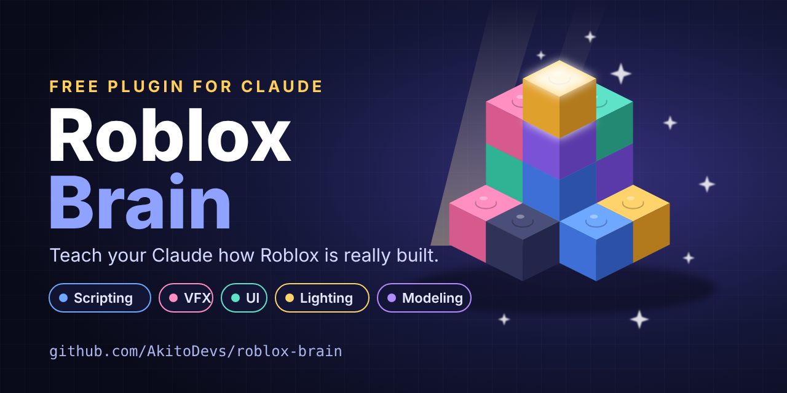
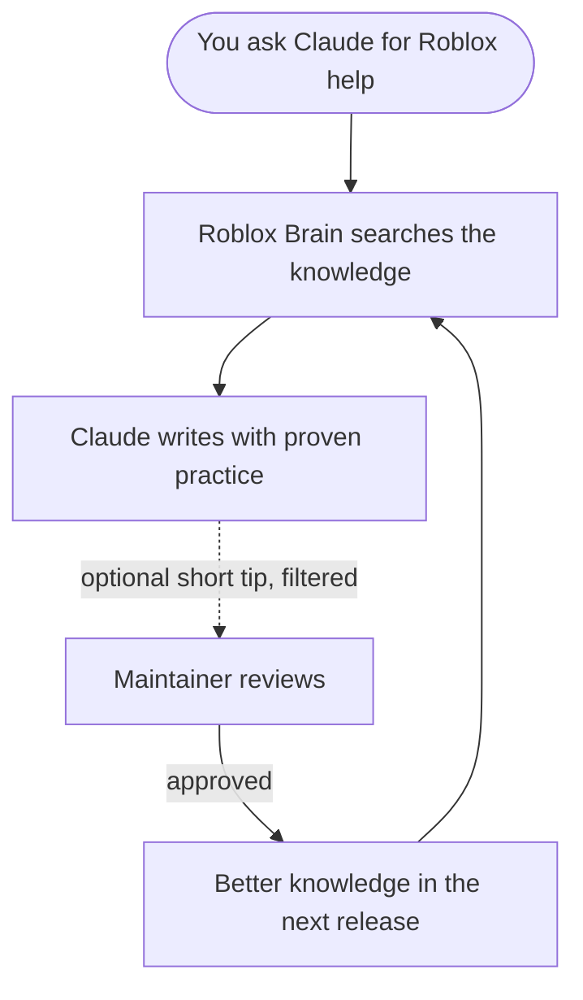

<div align="center">



<br>

[](LICENSE)


**Better Roblox help from your Claude, for scripting, VFX, UI, lighting, modeling and more.**

[Install](#install) · [What you get](#what-you-get) · [How it works](#how-it-works) · [Sharing and privacy](#sharing-tips-and-privacy) · [Usage cost](#usage-cost)

</div>

---

> **Found a problem?** [Open an issue](../../issues) and it will get looked at.

## What you get

Roblox Brain is a free plugin for Claude. It gives your Claude a curated, generic Roblox knowledge base and checks it before writing Roblox code, so your results start from solid practice instead of guesswork.

| Area | Helps Claude with |
|---|---|
| **Scripting** | Luau patterns, client and server structure, remotes, data saving, performance |
| **VFX** | Particles, beams, trails, timing and color so effects read well |
| **UI** | Responsive layouts, clean menus, animation and polish |
| **Lighting** | Mood, light direction, glow, color grading and atmosphere |
| **Modeling** | Shapes, detail, color and building props that look crafted |
| **Game design** | Retention, onboarding, ethical monetization and the publish checklist |

The knowledge is written in our own words, kept generic, and checked before every release. It never replaces the skills you already have. Claude uses whichever fits the task best.

## Install

You need [Claude Code](https://claude.com/claude-code) and Node.js 18 or newer. There is no `npm install` step.

Inside Claude Code, run:

```
/plugin marketplace add AkitoDevs/roblox-brain
/plugin install roblox-brain@roblox-brain
```

Restart Claude Code, then ask it to build something for Roblox. It looks at the knowledge first.

Prefer a terminal?

```bash
claude plugin marketplace add AkitoDevs/roblox-brain
claude plugin install roblox-brain@roblox-brain
```

**Update later:**

```bash
claude plugin marketplace update roblox-brain
claude plugin update roblox-brain@roblox-brain
```

<details>
<summary><b>Get new knowledge automatically</b></summary>

<br>

Auto-update is off by default for marketplaces like this one. To turn it on once:

1. In Claude Code, run `/plugin` and open the **Marketplaces** tab.
2. Select **roblox-brain**, then select **Enable auto-update**.

Claude Code then checks for a new release in the background after you start a session. The new knowledge loads the next time you start Claude Code, or right away with `/reload-plugins`.

</details>

## How it works



1. **Ask as usual.** When your task is about Roblox, Claude searches the knowledge first.
2. **Better output.** It uses what it finds, plus anything you already have installed.
3. **Tips flow back.** After a task, Claude may share one short, filtered tip about what worked.
4. **Everyone benefits.** The maintainer reviews tips by hand, and approved ideas go into the next release.

## Sharing tips and privacy

Sharing is on by default and easy to turn off. The first time you use Roblox Brain in a project, Claude shows a short notice explaining it. Nothing is shared in that project before then.

- **What a tip contains:** the topic, the problem, the fix and any Roblox API names. That's all.
- **What it leaves out:** your code, names, ids, links and emails. Tips are filtered on your computer before they are sent, and again on the server.
- **You can see everything:** each shared tip is saved in your sharing history at `~/.roblox-brain/sent-lessons.md`.
- **Nothing is merged automatically:** every tip is reviewed by hand before it can change the knowledge.

Say any of these in Claude Code:

| Say | What happens |
|---|---|
| "turn off Roblox Brain sharing" | Stops sharing everywhere on your computer |
| "turn on Roblox Brain sharing" | Turns it back on |
| "show my shared tips" | Shows your sharing history |
| "delete my shared tips" | Deletes everything you've shared from the maintainer's copy |

The full details, including retention and what happens if the project ever ends, are in [PRIVACY.md](PRIVACY.md).

## Usage cost

Roblox Brain uses a small amount of your Claude usage. Measured with Claude Code's `/context` and real sessions:

- **In every session:** about 350 tokens, whether or not you do Roblox work. The 4 tool definitions (about 600 tokens) load only when Claude first uses one.
- **In a Roblox task:** one search returns the best match in full plus 2 short excerpts, usually about 700 tokens and never much over 1,200. In our test of a simple shop UI request, a session that searched the knowledge cost about 15% more than the same request without the plugin.
- **Kept small on purpose:** Claude searches once per task, only for Roblox or Luau work, and never repeats a search. Our tests fail if the always-on part or a search result grows past its limit.

Run `/context` in Claude Code and look for `roblox-brain` to see it yourself. Numbers vary with your setup and model, so treat them as estimates.

## Contributing

- **Found a bug or have an idea?** [Open an issue](../../issues).
- **Want to help improve the knowledge?** Just use the plugin with sharing on. Good tips from real projects are the best source.
- **Maintainer notes:** how releases, triage and the review loop work are in [docs/MAINTAINING.md](docs/MAINTAINING.md).

## License

MIT, see [LICENSE](LICENSE). The knowledge entries in `knowledge/` are part of this repository and are included under the same license.

<div align="center">

<sub>Roblox Brain is an independent community project and is not affiliated with Roblox Corporation.</sub>

</div>
